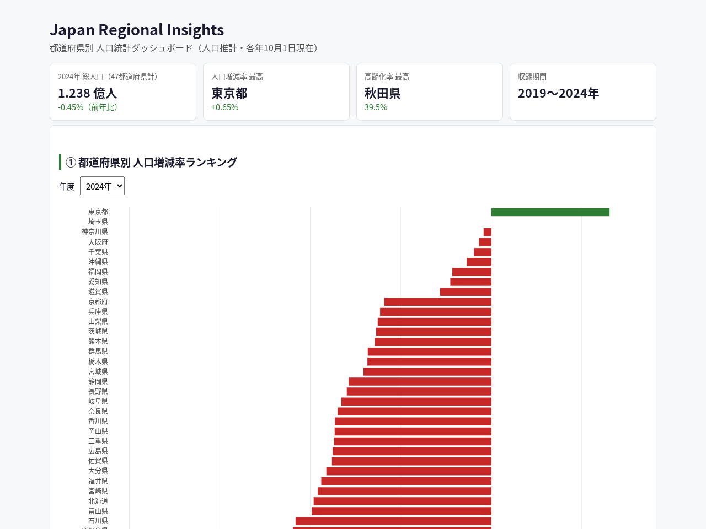
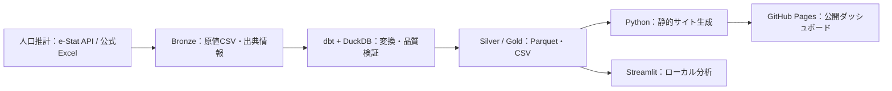

# Japan Regional Insights

[公開ダッシュボードを見る](https://yutarowada0402.github.io/japan-regional-insights/) · [CI の実行結果](https://github.com/yutarowada0402/japan-regional-insights/actions/workflows/ci.yml)

[](https://github.com/yutarowada0402/japan-regional-insights/actions/workflows/ci.yml)



日本の都道府県別人口統計を分析・可視化するWebアプリケーションです。
政府のオープンデータ（総務省統計局「人口推計」）を使い、人口増減率ランキング、
人口推移、地域比較、高齢化率との相関をインタラクティブに確認できます。

データエンジニアリングのポートフォリオとして、Python によるデータ取得、
dbt + DuckDB によるデータモデリング（Medallion アーキテクチャ）、
GitHub Actions による CI/CD、静的HTML（GitHub Pages）／Streamlit による可視化を一貫して実装しています。

## 機能（MVP）

1. **都道府県別 人口増減率ランキング** — 年度選択、増加/減少の色分け、棒グラフ+テーブル
2. **都道府県別 人口推移** — 折れ線グラフと年次増減率
3. **地域比較** — 最大3都道府県の人口推移と増減率を比較
4. **高齢化率 × 人口増減率の相関分析** — 散布図（地域名ホバー）と相関係数
   ※ 相関関係と因果関係は別物である旨の説明を画面上に明記しています
5. **コロプレスマップ**（追加機能）— 高齢化率・人口増減率・総人口を地図で表示
   境界データは国土数値情報（行政区域データ、国土交通省）を加工した
   `assets/boundaries/japan-prefectures-*.geojson`（先行ブランチで作成された境界データを再利用し、
   座標の丸め・小島嶼の省略・複数ファイル分割による軽量化を施したもの）

## アーキテクチャ



GitHub Actions が CI、毎月のデータ取得・検証・コミット、静的サイトの生成・公開を実行します。

- **Bronze**: API/Excel から取得した生データ（千人単位の原値）と出典情報を保持。再処理可能。
- **Silver**（dbt staging）: 都道府県コード統一（`01000` → `01`）、型変換、人単位への換算、重複排除。
- **Gold**（dbt marts）: 中心テーブル `fact_regional_indicator`（region_code × year × indicator_code）と、
  ダッシュボード向けの `gold_prefecture_year`（総人口、高齢者人口、高齢化率、人口増減率）。
- 指標: `total_population`（総人口）、`elderly_population`（65歳以上人口）を基礎指標とし、
  `population_change_rate`（前年比 %）と `aging_rate`（%）を Gold で算出します。

## データソース

| 項目 | 内容 |
|---|---|
| 統計名 | 人口推計（政府統計コード 00200524） |
| 提供機関 | 総務省統計局 |
| 対象 | 都道府県・年齢（3区分）・男女別人口（総人口）、各年10月1日現在 |
| 対象年度 | API 経路：2016〜2024年（9年分）。Excel 経路：2019・2021〜2024年（5年分）。各年47都道府県 |
| 原単位 | 千人（パイプラインで人単位に換算） |
| 取得経路1（主） | e-Stat API: 統計表ID `0004021110`（2016〜2020）、`0003448225`（2021〜2024） |
| 取得経路2（予備） | 統計局サイトの公表 Excel（各年 第3表、2019・2021〜2024年分） |
| 関連表 | 年齢（5歳階級）表 `0003448237`（2020〜2024）の所在を getMetaInfo で確認済み（本MVPでは未使用） |

詳細な出典記録は [`data/source_manifest.csv`](data/source_manifest.csv) を参照してください。

現在の公開データは Excel 経路で取得した **2019・2021〜2024年（235行）** です。
2020年は含まれていません。取得経路の切り替えはデータの追加ではなく、取得対象全体の置き換えになります。
対象年は [`src/ingestion/sources.py`](src/ingestion/sources.py) で定義しているため、月次更新で新しい年度が自動追加されるわけではありません。

注意点:

- 人口増減率は、同じ都道府県の直前の暦年の人口がある場合だけ算出します。初年度や欠年の翌年は空欄とし、補完しません。現在の公開データでは2019年・2021年が空欄です。
- Excel 経路の総人口は年齢3区分の合計のため、公表総数と最大1千人程度の丸め差が生じます。

## ローカル実行手順

前提: Python 3.12+、Git。以下は bash / zsh 向けの手順です。

```bash
git clone https://github.com/yutarowada0402/japan-regional-insights.git
cd japan-regional-insights
```

コミット済みの公的統計データから起動する場合、API キーやデータの再取得は不要です。

```bash
python3.12 -m venv .venv
source .venv/bin/activate
pip install -r requirements.txt

# 1) コミット済み Bronze から Gold/Silver の Parquet・CSV を生成
python -m src.processing.build_dataset

# 2) アプリ起動
streamlit run app/streamlit_app.py
```

データを再取得する場合は、次のコマンドの後に `build_dataset` を再実行します。

```bash
# キー未設定なら公式 Excel 経路。キーを使う場合のみ次のコメントを外します。
# export ESTAT_APP_ID='実際の e-Stat アプリケーションID'
python -m src.ingestion.download
```

テスト:

```bash
pytest -q
ruff check src app tests
# パスを自動設定し、実データで dbt build とエクスポートを検証
python -m src.processing.build_dataset
```

## CI/CD（GitHub Actions）

- **CI**（`.github/workflows/ci.yml`）: Pull Request・main push・手動実行で ruff、pytest、dbt build（テスト用フィクスチャ使用）を実行。
- **データ更新**（`.github/workflows/data-update.yml`）: 毎月2日06:17 JST + 手動実行。
  取得 → Bronze → dbt 変換 → 検証 → Gold 生成を一時領域で行い、成功した場合のみ公開データを差し替えます。
  差分がある場合のみコミットします（`GITHUB_TOKEN` の push は他ワークフローを起動しないため無限ループになりません）。
- **Pages デプロイ**（`.github/workflows/pages.yml`）: main への push・手動実行・月次データ更新成功時に、データ再生成 → 静的サイト生成 → GitHub Pages へデプロイします。

### ESTAT_APP_ID について

- e-Stat API を使う場合のみ必要です。リポジトリの Settings → Secrets and variables → Actions に
  `ESTAT_APP_ID` を登録してください（ユーザーが自身のアプリケーションIDを登録する前提です）。
- 未登録の場合は自動的に公式 Excel 経路にフォールバックします。
- ローカルでも環境変数未設定なら Excel 経路で動作します。キーをコードやリポジトリに含めることはありません。

## デプロイ（公開）

**公開は GitHub Pages（静的HTML）を第一とします。** Streamlit版はローカル実行用です。

### GitHub Pages（静的HTML版）

Goldデータから自己完結した静的サイトを生成し、`docs/` に出力します
（データと境界GeoJSONを埋め込み、描画はブラウザ側の Plotly.js。年度・地域フィルターもブラウザ上で動作）。

```bash
python -m src.processing.build_static_site   # docs/index.html を生成
```

公開手順:

1. リポジトリの Settings → Pages → Build and deployment → Source で **GitHub Actions** を選択（初回のみ、リポジトリ所有者が実施）。
2. `.github/workflows/pages.yml` が main への push・手動実行・月次データ更新成功時に、データ再生成 → 静的サイト生成 → Pages へデプロイを行います。
3. 公開URLは `https://yutarowada0402.github.io/japan-regional-insights/` です。

ローカル確認は `docs/index.html` をブラウザで開くだけで可能です（Plotly.js は CDN 読込、失敗時は同梱の `docs/plotly.min.js` にフォールバック）。

### Streamlit版（ローカル実行用）

```bash
streamlit run app/streamlit_app.py
```

アプリはリポジトリ内の `data/gold/prefecture_year.parquet`（無ければ `.csv`）を読みます。
静的版と同じ5つの分析ビュー（ランキング・推移・比較・相関・地図）と KPI を備えます。

## ディレクトリ構成

```
├── assets/                    # 地図境界データ・README 用スクリーンショット
├── app/streamlit_app.py        # Streamlit ダッシュボード
├── src/ingestion/              # データ取得（e-Stat API / 公式Excel）
├── src/processing/             # 変換ヘルパーとビルド統括
├── dbt/                        # dbt プロジェクト（staging / marts / seeds / tests）
├── docs/                       # GitHub Pages 用の静的サイト（生成物）
├── data/
│   ├── bronze/                 # 生データ（CSV）
│   ├── silver/                 # Silver 層（Parquet + CSV）
│   ├── gold/                   # Gold 層（Parquet + CSV）※アプリの参照先
│   └── source_manifest.csv     # 出典マニフェスト
├── tests/                      # pytest（変換ロジック、パーサー、アプリ起動確認）
└── .github/workflows/          # CI / データ更新 / Pages 公開
```

## ライセンス

MIT License（`LICENSE` ファイル参照）。データの出典は「人口推計」（総務省統計局）です。
